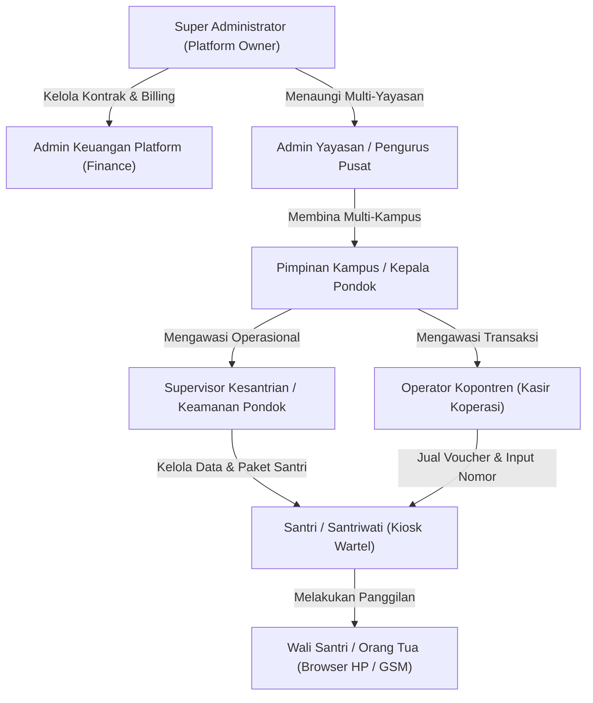
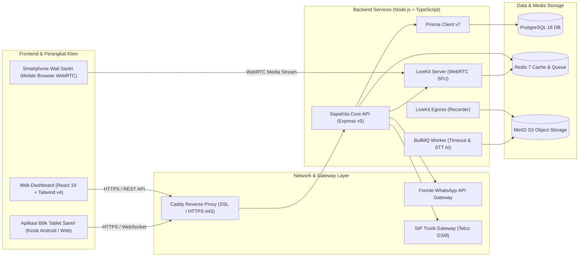
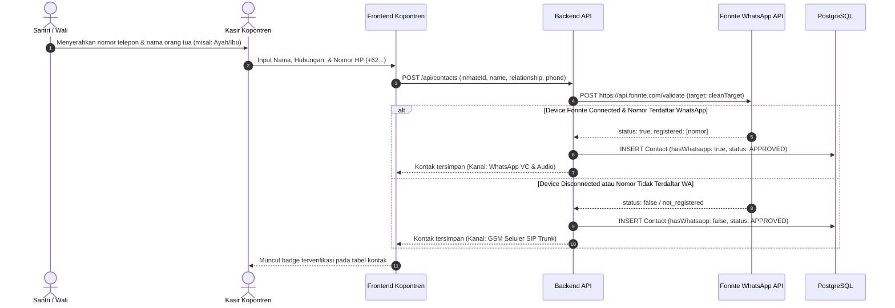
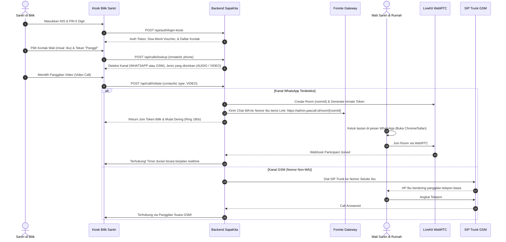

# PRODUCT REQUIREMENTS DOCUMENT (PRD)
## SISTEM KOMUNIKASI WARTEL PESANTREN TERPADU — "SAPAKITA"
**Versi Dokumen:** 2.0 (Rebranding & Production Specification)  
**Status Dokumen:** Approved / Master Reference for Engineering & AI Agents  
**Tanggal Terbit:** 24 November 2026  
**Klasifikasi:** Konfidensial — Standar Acuan Pengembangan Sistem SapaKita  

---

## 1. RINGKASAN EKSEKUTIF PRODUK (EXECUTIVE SUMMARY)

### 1.1. Visi Produk & Identitas Merek
**SapaKita** (*"Satu Sapaan, Sejuta Kedekatan — Dekatkan Hati, Sempurnakan Silaturahmi"*) adalah platform ekosistem komunikasi digital terpadu berbasis web, tablet kiosk, dan media gateway WebRTC/telefoni yang dirancang khusus untuk lingkungan **Pondok Pesantren**. 

SapaKita menyediakan sarana telekomunikasi modern (Panggilan Suara dan Panggilan Video / Video Call HD) yang aman, terkontrol, terdata rapi, dan berkeadilan bagi **Santri / Santriwati** untuk dapat terus terhubung dengan **Wali Santri (Orang Tua)** tanpa melanggar regulasi ketat pesantren mengenai larangan kepemilikan smartphone pribadi.

### 1.2. Masalah yang Diselesaikan (Problem Statement)
1. **Regulasi Larangan Smartphone:** Mayoritas pondok pesantren melarang santri membawa telepon genggam pribadi demi fokus belajar, adab, dan menghindari distraksi media sosial/konten negatif. Namun, santri tetap membutuhkan sarana untuk berkomunikasi dengan orang tua.
2. **Keterbatasan Fasilitas Wartel Konvensional:** Antrean telepon pondok konvensional seringkali manual, tidak memiliki pencatatan durasi bicara yang transparan, minim pengawasan visual/audio, dan tidak mendukung panggilan video (tatap muka).
3. **Risiko Penyelundupan Gadget Ilegal:** Kurangnya akses komunikasi resmi mendorong potensi pelanggaran disiplin (penyelundupan smartphone ilegal ke asrama/kamar).
4. **Kebutuhan Pengawasan Keamanan Santri:** Pihak pengasuh/pimpinan pondok memerlukan jaminan bahwa komunikasi santri hanya ditujukan kepada wali yang sah, serta memiliki arsip rekaman pembicaraan otomatis untuk mengantisipasi potensi perundungan (*bullying*), indikasi pelarian santri, maupun masalah psikologis santri sedini mungkin.

### 1.3. Solusi Terintegrasi SapaKita
1. **Bilik Wartel Santri Modern (Kiosk Tablet):** Perangkat tablet layar sentuh di bilik telepon pesantren dengan antarmuka ramah santri, login menggunakan Nomor Induk Santri (NIS) dan PIN 6 digit rahasia.
2. **Dual-Channel Call Routing (WebRTC & GSM Fallback):**
   - **Kanal Utama (WhatsApp + WebRTC LiveKit):** Mengirimkan tautan terenkripsi melalui WhatsApp resmi SapaKita ke smartphone wali santri. Wali santri dapat langsung membuka browser smartphone untuk melakukan Video Call atau Telepon Suara jernih tanpa perlu menginstal aplikasi rumit.
   - **Kanal Cadangan (SIP Trunk GSM Seluler):** Jika nomor telepon wali santri tidak memiliki WhatsApp atau paket data wali sedang mati, panggilan dialihkan secara cerdas melalui jaringan telepon seluler GSM (PSTN) sebagai panggilan suara biasa.
3. **Perekaman Otomatis & Transkripsi Teks AI (STT Whisper):** Seluruh percakapan direkam dan disimpan aman selama 1 tahun di Object Storage (MinIO/S3), dilengkapi transkrip teks otomatis berbasis kecerdasan buatan (*Speech-to-Text*) untuk pemantauan kepatuhan adab santri.
4. **Monetisasi & Kasir Koperasi Pondok Pesantren (Kopontren):** Sistem voucher pulsa terintegrasi di kasir Kopontren, mendukung struk kasir termal, bagi hasil transparan antara Yayasan/Pesantren dan Penyedia Platform, serta pencatatan tagihan pascabayar per detik bicara.
5. **Pemantauan Video CCTV Bilik Santri (Live Streaming & Arsip Pengawasan):** Modul pengawasan visual langsung (*real-time video streaming*) dan peninjauan rekaman berkala bilik wartel serta area antrean santri berbasis HLS player untuk memastikan keamanan, ketertiban, dan kedisiplinan santri di lingkungan pesantren.

---

## 2. MATRIKS PERUBAHAN ISTILAH & ENUM (REBRANDING MAPPING)

Untuk menjamin konsistensi 100% pada seluruh baris kode, dokumentasi API, skema database, dan antarmuka pengguna (UI/UX), tabel berikut menjadi acuan mutlak perubahan terminologi dari sistem lama (Sadewa / PasCall) ke **SapaKita**:

| Terminologi Lama (Sadewa - Lapas) | Terminologi Baru (SapaKita - Pesantren) | Keterangan & Konteks Penggunaan |
|---|---|---|
| **WBP (Warga Binaan Pemasyarakatan)** | **Santri / Santriwati** | Pengguna pemilik akun pemanggil di bilik wartel pesantren. |
| **Nomor Registrasi WBP / NIP** | **NIS (Nomor Induk Santri)** | Identitas alfanumerik unik santri untuk login ke bilik. |
| **Keluarga / Penjamin / Family** | **Wali Santri / Orang Tua** | Pihak keluarga penerima panggilan telepon/video call. |
| **Lapas / Rutan / UPT / Branch** | **Komplek Pondok Pesantren** | Entitas cabang pesantren (misal: Kampus Putra, Kampus Putri). |
| **Kanwil (Kantor Wilayah)** | **Yayasan / Pengurus Pusat** | Badan hukum/induk yayasan yang menaungi multi-kampus. |
| **Wartelsus / Bilik Telepon Lapas** | **Wartel Santri / Bilik Telepon Santri** | Fasilitas bilik fisik tempat tablet/kios telepon ditempatkan. |
| **Kantin Lapas / Canteen** | **Koperasi Pondok Pesantren (Kopontren)** | Unit usaha pesantren tempat santri membeli voucher panggilan. |
| **Inkopasindo** | **DITIADAKAN / DIHAPUS** | **Role, menu, dan bagi hasil Inkopasindo dihapus 100%.** |
| **Blok / Kamar Sel** | **Asrama / Kamar Santri** | Lokasi gedung asrama santri (misal: "Asrama Al-Fatih / Kamar 04"). |
| **Sadewa / PasCall** | **SapaKita** | Identitas platform, nama aplikasi, dan domain operasional. |

---

## 3. ROLE-BASED ACCESS CONTROL (RBAC) & STRUKTUR HAK AKSES

Sistem SapaKita memiliki **8 peran pengguna resmi**. Role `INKOPASINDO` dari sistem lama telah dihapus sepenuhnya.



### 3.1. Super Administrator (`SUPERADMIN`)
- **Deskripsi:** Pemilik dan pengelola teknis tertinggi platform SapaKita.
- **Wewenang & Hak Akses:**
  - Manajemen Yayasan (CRUD Yayasan Pesantren & penetapan Admin Yayasan).
  - Manajemen Kampus Pesantren (CRUD Kampus/Komplek Pondok di bawah Yayasan).
  - Konfigurasi Kontrak Bisnis Platform: Penentuan persentase bagi hasil (`contractSharePercentage`), tarif acuan dasar per detik (`contractRatePerSecond`), dan penerbitan faktur tagihan pascabayar ke Kopontren.
  - Audit Trail Global, Monitoring Server LiveKit, log panggilan nasional, dan rilis aplikasi Android Kiosk (`app-releases`).

### 3.2. Admin Yayasan / Pengurus Pusat (`KANWIL_ADMIN`)
- **Deskripsi:** Pengurus Yayasan Induk yang menaungi beberapa cabang/kampus pondok pesantren.
- **Wewenang & Hak Akses:**
  - Melihat agregat statistik panggilan, durasi bicara, dan pertumbuhan santri di seluruh kampus naungan yayasan.
  - Meninjau daftar kampus pesantren binaan beserta pimpinan kampus yang bertugas.
  - Audit riwayat panggilan dan akses dengar rekaman panggilan santri lintas kampus untuk pengawasan mutu asrama.
  - Akses read-only terhadap rekapitulasi penjualan voucher kopontren per kampus.

### 3.3. Pimpinan Kampus / Kepala Pondok (`BRANCH_ADMIN`)
- **Deskripsi:** Pimpinan tertinggi di kampus/komplek pondok pesantren tertentu (misal: Kepala Pondok Kampus Putri).
- **Wewenang & Hak Akses:**
  - Dashboard statistik komunikasi santri khusus kampus yang dipimpinnya.
  - Manajemen akun staf pondok (membuat dan mengelola akun Supervisor Pondok dan Kasir Kopontren).
  - Pemantauan rekaman panggilan santri: Memutar rekaman audio/video, membaca transkrip teks hasil Speech-to-Text (STT AI) untuk investigasi kedisiplinan dan adab santri.
  - Pemantauan visual CCTV bilik santri secara langsung (live stream HLS) dan arsip rekaman video keamanan.
  - Meninjau laporan keuangan penjualan voucher di Koperasi Pondok Pesantren kampusnya.

### 3.4. Supervisor Kesantrian / Keamanan Pondok (`SUPERVISOR`)
- **Deskripsi:** Divisi Keamanan, Bagian Pengasuhan, atau Kesantrian yang bertugas langsung di lapangan.
- **Wewenang & Hak Akses:**
  - **Manajemen Santri:** Pendaftaran santri baru, edit data, upload berkas foto santri, dan **Import Massal Santri via berkas Excel/CSV**.
  - **Kontrol Hak Komunikasi:** Mengubah status komunikasi santri (`Aktif` atau `Nonaktif` / diskorsing panggilan akibat pelanggaran tata tertib pondok).
  - **Reset PIN Santri:** Melakukan reset PIN bilik jika santri lupa PIN.
  - **Manajemen Paket Voucher Kampus:** Membuat dan mengatur tarif paket komunikasi khusus kampus pondoknya (contoh: Paket Hemat 5 Menit, Paket Rindu 25 Menit) dengan durasi bicara dan harga jual rupiah.
  - **Pemantauan CCTV Bilik:** Memantau siaran langsung kamera CCTV di bilik telepon dan area antrean wartel santri.
  - Verifikasi dan persetujuan kontak wali santri jika memerlukan approval manual.

### 3.5. Operator Kopontren / Kasir Koperasi (`CANTEEN_STAFF`)
- **Deskripsi:** Petugas kasir Koperasi Pondok Pesantren (Kopontren).
- **Wewenang & Hak Akses:**
  - **Kasir Penjualan Voucher:** Memilih santri berdasarkan nama/NIS, memilih paket komunikasi yang diinginkan, memilih metode pembayaran (Tunai / Saldo Santri), dan memproses transaksi.
  - **Pencetakan Struk:** Mencetak struk fisik termal berisi **Kode Voucher Unik 5 Karakter** (misal: `A8K92`) beserta NIS santri dan tanggal kedaluwarsa.
  - **Pendaftaran Kontak Wali Santri:** Mendaftarkan nomor telepon HP orang tua/wali santri (maksimal 10 kontak per santri). Sistem otomatis memvalidasi apakah nomor memiliki akun WhatsApp aktif.
  - **Riwayat Penjualan & Tagihan:** Melihat riwayat transaksi penjualan voucher kopontren harian serta rincian tagihan pascabayar ke pihak pengelola platform SapaKita.

### 3.6. Santri / Santriwati (`INMATE`)
- **Deskripsi:** Santri yang berada di lingkungan pondok pesantren dan menggunakan bilik telepon wartel santri.
- **Wewenang & Hak Akses (Aplikasi Tablet Kiosk):**
  - Login bilik menggunakan **Nomor Induk Santri (NIS)** dan **PIN 6 digit**.
  - Aktivasi/Penebusan voucher dengan menginput kode 5 digit voucher yang dibeli di Kopontren.
  - Melihat sisa kuota durasi bicara aktif (dalam menit dan detik) serta masa berlaku voucher.
  - Memilih kontak wali santri yang sudah terdaftar dan terverifikasi di whitelist.
  - Melakukan panggilan **Telepon Suara** atau **Panggilan Video (Video Call)** sesuai kuota voucher.

### 3.7. Wali Santri / Orang Tua (`FAMILY`)
- **Deskripsi:** Orang tua, wali, atau keluarga sah santri yang nomornya telah didaftarkan dan disetujui.
- **Wewenang & Interaksi Pengguna:**
  - Menerima pesan notifikasi otomatis dari akun resmi WhatsApp SapaKita saat santri melakukan inisiasi panggilan dari bilik pondok.
  - Mengetuk tautan (*link join*) pada pesan WhatsApp untuk langsung membuka browser smartphone (Chrome, Safari, dsb.) dan terhubung melalui WebRTC LiveKit tanpa perlu registrasi/login akun.
  - Jika tidak memiliki koneksi internet/WhatsApp, wali santri menerima panggilan masuk seluler biasa melalui jaringan GSM SIP Trunk.

### 3.8. Admin Keuangan Platform (`FINANCE`)
- **Deskripsi:** Tim finansial pengelola platform SapaKita (Superadmin Finance).
- **Wewenang & Hak Akses:**
  - Penagihan pascabayar ke seluruh Kopontren kampus pesantren.
  - Rekapitulasi detik bicara yang dibeli per bulan berdasarkan transaksi kasir kopontren.
  - Konfigurasi rekening bank penampung bagi hasil dan validasi bukti transfer setoran Kopontren.

---

## 4. ARSITEKTUR TEKNOLOGI & INFRASTRUKTUR SISTEM

Ekosistem SapaKita dibangun di atas arsitektur *micro-monolith* yang modular, berkinerja tinggi, dan terisolasi per tenant (kampus).



### 4.1. Spesifikasi Komponen Teknologi (Tech Stack)

| Lapisan Sistem | Teknologi / Library | Versi | Peran & Tanggung Jawab |
|---|---|---|---|
| **Frontend Web** | React.js | 19.x | Dashboard Admin, Yayasan, Kampus, SPV, Kopontren. |
| **Bundler & Build** | Vite | 6.x | Fast HMR & optimized production build. |
| **Styling UI** | Tailwind CSS | 4.x | Utility-first CSS, responsive design modern. |
| **UI Components** | Lucide React, Recharts | Latest | Iconography & grafik statistik analitik. |
| **Backend Runtime** | Node.js | v20 LTS | Engine eksekusi backend modular. |
| **Bahasa Backend** | TypeScript | 5.x / 7.x | Type safety, maintainability, clean architecture. |
| **Framework API** | Express.js | 5.2.x | REST API server, JWT authentication, role guards. |
| **Database Relasional**| PostgreSQL | 16-alpine | Database transaksi, santri, kontak, voucher, log. |
| **ORM Client** | Prisma ORM (`@prisma/adapter-pg`) | 7.10.x | Type-safe schema modeling, migrasi database. |
| **Caching & Message** | Redis | 7-alpine | Rate limiting, lock sesi panggilan, BullMQ broker. |
| **Background Job** | BullMQ | 6.3.x | Worker pemantau timeout panggilan, antrean STT AI. |
| **Media Server** | LiveKit Server | 2.19.x | WebRTC SFU untuk video & audio call terenkripsi. |
| **Audio Recorder** | LiveKit Egress | Latest | Merekam stream media secara langsung ke S3. |
| **Object Storage** | MinIO (AWS S3 Compatible) | Latest | Penyimpanan berkas rekaman audio/video (.mp4/.ogg). |
| **WhatsApp Gateway** | Fonnte API Engine | SaaS | Validasi keberadaan nomor WhatsApp & kirim tautan. |
| **Telefoni GSM** | SIP Trunk Gateway | Asterisk/Telco | Panggilan suara GSM jika WhatsApp tidak tersedia. |
| **Speech-to-Text** | Whisper Large-v3 (via Groq/OpenAI) | API | Transkripsi teks otomatis dari berkas rekaman audio. |
| **CCTV Live Streaming** | HLS.js / MediaMTX / RTSP Gateway | HLS v1.7.x | Streaming video pemantauan bilik wartel dan area asrama santri. |

---

## 5. SPESIFIKASI ALUR KERJA UTAMA (CORE WORKFLOWS)

### 5.1. Alur Pendaftaran & Validasi Nomor Wali Santri
Setiap santri berhak memiliki maksimal **10 nomor kontak wali santri terdaftar**. Nomor kontak hanya dapat ditambahkan oleh Kasir Kopontren atau Supervisor Kampus.



### 5.2. Alur Pembelian & Pencetakan Voucher di Kopontren
1. Santri mendatangi kasir Kopontren untuk membeli paket bicara (contoh: *Paket Kangen 12 Menit — Rp 10.000*).
2. Kasir mencari santri berdasarkan NIS atau nama. Sistem menampilkan sisa kuota aktif santri saat ini.
3. Kasir memilih paket yang tersedia khusus untuk kampus santri tersebut (tanpa tercampur paket kampus lain).
4. Kasir menerima pembayaran (Tunai) dan menekan tombol **"Simpan & Cetak Struk"**.
5. Backend membuat transaksi (`CanteenTransaction`), mengunci kuota durasi ke tabel `Voucher` dengan masa berlaku default 7 hari, dan mengembalikan **Kode Voucher Unik 5 Karakter** (misal: `G7T29`).
6. Printer thermal kasir mencetak struk fisik berisi:
   - Nama Pesantren & Kampus
   - Nomor Invoice Transaksi
   - Nama Santri & NIS
   - Nama Paket & Durasi Menit
   - **KODE VOUCHER: G7T29** (Dicetak besar & tebal)
   - Batas Kedaluwarsa Voucher

### 5.3. Alur Panggilan Santri di Bilik Wartel (Dual-Routing)



### 5.4. Alur Pemutusan Otomatis, Perekaman & Transkripsi Teks AI
1. **Countdown & Hard Stop:** Sistem memantau detik pemakaian secara ketat. Ketika sisa durasi voucher santri tersisa 60 detik, bilik menampilkan peringatan audio/visual. Saat durasi tepat mencapai batas voucher, panggilan diputus secara otomatis oleh server (`TIMEOUT_EXPIRED`).
2. **Perekaman Egress:** Selama panggilan berlangsung, LiveKit Egress merekam aliran audio/video dan mengunggahnya langsung ke bucket MinIO `pascall-recordings`.
3. **Trigger Antrean STT AI:** Setelah rekaman selesai, record disimpan di database dan dimasukkan ke antrean BullMQ `transcription-queue`.
4. **Transkripsi Otomatis (Whisper AI):** Worker memproses berkas audio dan menghasilkan naskah percakapan lengkap yang disimpan ke kolom `transcriptText` pada tabel `Recording`.
5. **Akses Pengawasan:** Pimpinan Kampus dan Supervisor dapat membuka riwayat rekaman kapan saja, memutar pemutar audio/video presigned, dan membaca transkrip teks percakapan.

---

## 6. STRUKTUR SKEMA DATABASE UTAMA (PRISMA REFERENCE)

Berikut adalah definisi model data utama pada berkas `schema.prisma` yang telah disesuaikan dengan arsitektur SapaKita:

```prisma
enum Role {
  SUPERADMIN       // Pengelola Tertinggi Platform SapaKita
  KANWIL_ADMIN     // Admin Yayasan / Pengurus Pusat
  BRANCH_ADMIN     // Pimpinan Kampus / Kepala Pondok
  SUPERVISOR       // Pengurus Kesantrian / Keamanan Pondok
  CANTEEN_STAFF    // Petugas Kasir Koperasi Pondok Pesantren (Kopontren)
  INMATE           // Santri / Santriwati (Pengguna Kiosk Bilik)
  FAMILY           // Wali Santri / Orang Tua
  FINANCE          // Admin Keuangan Platform SapaKita
}

enum InmateCommStatus {
  Aktif            // Santri diizinkan menelepon
  Nonaktif         // Santri diskorsing / diblokir komunikasinya
}

enum ContactStatus {
  PENDING          // Menunggu persetujuan
  APPROVED         // Disetujui & aktif di whitelist
  REJECTED         // Ditolak
}

enum CallType {
  AUDIO            // Panggilan Suara (Telepon)
  VIDEO            // Panggilan Video (Video Call)
}

enum CallRouteType {
  LIVEKIT          // WebRTC via link WhatsApp
  SIP_TRUNK        // Seluler GSM via Telco Gateway
}

enum CallStatus {
  INITIATED
  RINGING
  CONNECTED
  ENDED
  REJECTED
  MISSED
  FAILED
}

// Entitas Yayasan / Pengurus Pusat (sebelumnya Kanwil)
model Kanwil {
  id        String   @id @default(uuid())
  code      String   @unique
  name      String   @unique // Contoh: "Yayasan Pondok Pesantren Modern Darussalam"
  region    String
  provinces String[] @default([])
  status    String   @default("Aktif")
  createdAt DateTime @default(now())
  updatedAt DateTime @updatedAt

  branches  Branch[]
  users     User[]
}

// Entitas Kampus / Komplek Pondok (sebelumnya Lapas/Branch)
model Branch {
  id                      String   @id @default(uuid())
  kanwilId                String?
  name                    String   // Contoh: "Pesantren Darussalam - Kampus Putri"
  province                String?
  location                String?
  address                 String?
  phone                   String?
  capacity                Int      @default(0) // Kapasitas santri
  contractSharePercentage Decimal  @default(50.00) @db.Decimal(5, 2) // Persentase bagi hasil SapaKita
  contractRatePerSecond   Decimal? @default(15.00) @db.Decimal(10, 2) // Tarif per detik dasar (Rp 15/dtk)
  status                  String   @default("Aktif")
  createdAt               DateTime @default(now())
  updatedAt               DateTime @updatedAt

  kanwil                  Kanwil?  @relation(fields: [kanwilId], references: [id])
  users                   User[]
  packages                Package[]
  wartelBooths            WartelBooth[]
}

// Akun Pengguna & Profil Santri
model User {
  id           String           @id @default(uuid())
  branchId     String?          // Relasi ke Kampus Pondok
  kanwilId     String?          // Relasi ke Yayasan
  role         Role             @default(FAMILY)
  identifier   String?          @unique // NIS (Nomor Induk Santri) untuk santri, atau Email untuk admin
  phone        String?          @unique // Nomor telepon HP
  email        String?          @unique
  name         String           // Nama lengkap santri / staf
  passwordHash String
  balance      Decimal          @default(0.00) @db.Decimal(12, 2)
  isActive     Boolean          @default(true)
  commStatus   InmateCommStatus @default(Aktif)
  blockRoom    String?          // Asrama & Kamar Santri (contoh: "Gedung Aisyah / Kamar 12")
  entryDate    DateTime?        // Tanggal Masuk Pesantren
  dateOfBirth  DateTime?        // Tanggal Lahir (opsional untuk verifikasi santri)
  createdAt    DateTime         @default(now())
  updatedAt    DateTime         @updatedAt

  branch           Branch?      @relation(fields: [branchId], references: [id])
  kanwil           Kanwil?      @relation(fields: [kanwilId], references: [id])
  contactsAsInmate Contact[]    @relation("InmateContacts")
  callsAsInmate    Call[]       @relation("InmateCalls")
  vouchersAsInmate Voucher[]    @relation("InmateVouchers")
}

// Whitelist Kontak Wali Santri
model Contact {
  id                String        @id @default(uuid())
  inmateId          String        // Relasi ke Santri
  phone             String        // Nomor HP Wali Santri (+62...)
  name              String?       // Nama Wali (misal: "H. Abdullah")
  relationship      String        // Hubungan: "Ayah", "Ibu", "Wali Sah"
  status            ContactStatus @default(APPROVED)
  approvedBy        String?
  hasWhatsapp       Boolean?      // Status deteksi otomatis gateway WA
  whatsappCheckedAt DateTime?
  createdAt         DateTime      @default(now())
  updatedAt         DateTime      @updatedAt

  inmate User @relation("InmateContacts", fields: [inmateId], references: [id])

  @@unique([inmateId, phone])
}

// Paket Voucher yang dibuat SPV per Kampus
model Package {
  id        String   @id @default(uuid())
  branchId  String?  // Wajib terikat ke Kampus tertentu
  name      String   // Contoh: "Paket Kangen Santri (12 Menit)"
  category  String   @default("telepon") // telepon / video
  duration  Int      // Durasi bicara dalam menit
  price     Decimal  @db.Decimal(12, 2)   // Harga jual rupiah di Kopontren
  status    String   @default("Aktif")
  createdAt DateTime @default(now())
  updatedAt DateTime @updatedAt

  branch Branch? @relation(fields: [branchId], references: [id])
}

// Saldo Kuota Durasi Bicara Aktif Santri
model Voucher {
  id               String        @id @default(uuid())
  code             String        @unique // 5 Karakter Unik (misal: "X9B21")
  inmateId         String        // Santri pemilik
  branchId         String        // Kampus asal
  packageId        String
  callType         CallType      // AUDIO atau VIDEO
  initialMinutes   Int           // Kuota awal menit
  remainingMinutes Int           // Sisa menit
  remainingSeconds Int           // Sisa detik (precision billing)
  status           VoucherStatus @default(ACTIVE)
  expiresAt        DateTime      // Batas kedaluwarsa voucher
  createdAt        DateTime      @default(now())
  updatedAt        DateTime      @updatedAt

  inmate User @relation("InmateVouchers", fields: [inmateId], references: [id])
}

// Transaksi Penjualan di Kasir Kopontren
model CanteenTransaction {
  id            String            @id // Format: TRX-YYYYMMDD-XXXX
  kodeVoucher   String            @unique
  branchId      String
  inmateId      String
  packageId     String
  cashierId     String            // Petugas Kasir Kopontren
  paymentMethod PaymentMethod     @default(TUNAI)
  status        TransactionStatus @default(BERHASIL)
  totalAmount   Decimal           @db.Decimal(12, 2)
  packageDuration Int             // Menit paket
  createdAt     DateTime          @default(now())
}

// Log Panggilan & Rekaman
model Call {
  id              String        @id @default(uuid())
  roomId          String        @unique
  inmateId        String        // Santri pemanggil
  targetPhone     String?       // Nomor Wali Santri tujuan
  type            CallType      // AUDIO / VIDEO
  routeType       CallRouteType @default(LIVEKIT)
  status          CallStatus    @default(INITIATED)
  durationSeconds Int           @default(0)   // Total detik bicara riil
  voucherCode     String?
  boothId         String?       // Bilik telepon yang digunakan
  connectedAt     DateTime?
  endedAt         DateTime?
  endReason       String?
  createdAt       DateTime      @default(now())

  inmate    User       @relation("InmateCalls", fields: [inmateId], references: [id])
  recording Recording?
}

// Berkas Rekaman & Transkrip Teks AI
model Recording {
  id               String   @id @default(uuid())
  callId           String   @unique
  storageUrl       String   // S3 Path rekaman audio/video
  transcriptText   String?  @db.Text // Transkrip percakapan hasil AI Whisper
  recordingStatus  String   @default("COMPLETED")
  transcriptStatus String   @default("PENDING")
  createdAt        DateTime @default(now())

  call Call @relation(fields: [callId], references: [id])
}

// Bilik Fisik Wartel Santri
model WartelBooth {
  id          String   @id @default(uuid())
  branchId    String
  boothNumber Int      // Nomor Bilik (Bilik 01, Bilik 02)
  status      String   @default("IDLE") // IDLE, RINGING, IN_USE, OFFLINE
  deviceUid   String?  // Hardware ID Tablet Kiosk
  ipAddress   String?
  updatedAt   DateTime @updatedAt

  branch Branch @relation(fields: [branchId], references: [id])
}
```

---

## 7. DAFTAR SPESIFIKASI ENDPOINT API UTAMA (API REFERENCE)

### 7.1. Modul Autentikasi (`/api/auth`)
* `POST /api/auth/login`: Login staf dashboard (Superadmin, Yayasan, Pimpinan Kampus, SPV, Kasir Kopontren). Mengembalikan JWT token dan data profil pengguna.
* `POST /api/auth/login-kiosk`: Login bilik wartel santri khusus aplikasi tablet. Menerima payload `{ identifier: string (NIS), pin: string (6 digit) }`.
* `GET /api/auth/me`: Mengambil data sesi pengguna aktif yang terotentikasi.
* `POST /api/auth/change-password`: Penggantian password akun staf.

### 7.2. Modul Santri (`/api/inmates`)
* `GET /api/inmates`: Mengambil daftar santri (dengan filter `branchId`, `search`, `commStatus`, paginasi `page` & `limit`).
* `POST /api/inmates`: Mendaftarkan santri baru secara manual oleh Supervisor Kampus.
* `POST /api/inmates/import`: Import massal data santri via berkas Excel (`.xlsx` / `.csv`) dengan validasi NIS ganda otomatis.
* `GET /api/inmates/:id`: Mengambil detail data santri, asrama, kamar, dan riwayat voucher aktif.
* `PATCH /api/inmates/:id`: Memperbarui data identitas santri.
* `PATCH /api/inmates/:id/status`: Mengubah izin komunikasi santri (`commStatus`: `Aktif` / `Nonaktif`).
* `POST /api/inmates/:id/reset-pin`: Melakukan reset PIN bilik santri menjadi PIN bawaan baru.

### 7.3. Modul Kontak Wali Santri (`/api/contacts`)
* `GET /api/contacts`: Mengambil daftar kontak wali santri (filter `inmateId`, `status`).
* `POST /api/contacts`: Mendaftarkan nomor wali santri baru (otomatis memicu validasi nomor ke WhatsApp Fonnte).
* `DELETE /api/contacts/:id`: Menghapus kontak wali santri dari whitelist santri.

### 7.4. Modul Kasir Kopontren (`/api/canteen`)
* `GET /api/canteen/packages`: Mengambil daftar paket komunikasi yang aktif khusus kampus santri tersebut.
* `POST /api/canteen/transactions`: Menyimpan transaksi pembelian voucher santri (menghasilkan kode voucher unik 5 karakter).
* `GET /api/canteen/transactions`: Riwayat transaksi penjualan voucher di kasir kopontren.
* `GET /api/canteen/billing/summary`: Mengambil ringkasan total tagihan pascabayar kopontren bulan berjalan berdasarkan total detik dari voucher yang dibeli santri.

### 7.5. Modul Panggilan & WebRTC (`/api/call` & `/api/calls`)
* `POST /api/calls/lookup`: Gating awal saat santri memasukkan/memilih nomor di bilik. Memeriksa keberadaan kontak di whitelist, status aktif santri, voucher aktif, dan mendeteksi rute kanal (`WHATSAPP` atau `GSM`).
* `POST /api/call/initiate`: Menginisiasi panggilan bilik santri. Jika WhatsApp, membuat room LiveKit dan mengirim pesan chat resmi ke WhatsApp wali santri. Jika GSM, memicu dialler SIP Trunk.
* `POST /api/call/end`: Mengakhiri panggilan secara normal oleh santri atau wali santri.
* `GET /api/calls`: Riwayat panggilan komprehensif dengan filter tanggal, kampus, jenis panggilan (Audio/Video), dan kanal (Web/GSM).
* `GET /api/calls/channel-summary`: Endpoint agregasi performa tinggi untuk kartu ringkasan total detik Web vs total detik GSM tanpa dibatasi paginasi tabel.

### 7.6. Modul Rekaman & Transkrip AI (`/api/recordings`)
* `GET /api/recordings`: Daftar rekaman panggilan santri yang tersedia.
* `GET /api/recordings/stream/:id`: Mendapatkan presigned URL aman untuk memutar audio/video dari MinIO S3.
* `GET /api/recordings/:id/transcript`: Mengambil teks transkrip percakapan hasil Speech-to-Text Whisper AI.

### 7.7. Modul Kampus & Yayasan (`/api/branches` & `/api/kanwil`)
* `GET /api/kanwil`: Mengambil daftar yayasan pesantren naungan.
* `POST /api/kanwil`: Mendaftarkan yayasan baru oleh Superadmin.
* `GET /api/branches`: Mengambil daftar kampus pesantren (mendukung filter `kanwilId`).
* `POST /api/branches`: Mendaftarkan kampus pondok baru lengkap dengan konfigurasi persentase bagi hasil platform.

### 7.8. Modul Pemantauan CCTV (`/api/cctv`)
* `GET /api/cctv/streams`: Mengambil daftar kamera CCTV aktif di bilik telepon dan area antrean santri per kampus pondok.
* `GET /api/cctv/recordings`: Mengambil daftar potongan arsip rekaman video keamanan berdasarkan tanggal dan bilik.

---

## 8. ATURAN BISNIS KRUSIAL (CRITICAL BUSINESS RULES)

1. **Isolasi Paket Kampus yang Ketat (No Global Fallback):**
   - Kasir Kopontren **HANYA** diizinkan menjual paket voucher yang memiliki `branchId` sama persis dengan kampus tempat kasir bertugas.
   - Paket bawaan global (`branchId: null`) dilarang keras muncul di kasir kopontren agar tidak terjadi kekeliruan penetapan harga antar-pesantren. Jika Supervisor belum membuat paket, daftar paket kopontren harus tampil kosong.
2. **Whitelist Kontak Tertutup (Closed Loop Calling):**
   - Santri hanya dapat menghubungi nomor wali santri yang berstatus `APPROVED` dan terdaftar di whitelist miliknya (maksimal 10 nomor).
   - Santri tidak dapat melakukan panggilan bebas (*unregistered dialing*) ke sembarang nomor demi keamanan dan kepatuhan pesantren.
3. **Deduplikasi Pesan WhatsApp (1 Panggilan = 1 Chat WA):**
   - Sistem memiliki cache deduplikasi (3 menit). Satu inisiasi panggilan hanya mengirimkan tepat satu pesan WhatsApp ke wali santri untuk mencegah pembatasan spam oleh WhatsApp.
4. **Perhitungan Tagihan Pascabayar Berbasis Pembelian Voucher:**
   - Tagihan bagi hasil pengelola platform SapaKita kepada Kopontren dihitung berdasarkan **total detik dari voucher yang dibeli santri di kasir kopontren**, bukan menunggu santri menghabiskan durasi di bilik. Hal ini menjamin keadilan bisnis karena masa berlaku voucher bersifat pasti (hangus setelah 7 hari).
5. **Format Nomor Telepon Standar:**
   - Seluruh nomor telepon disimpan dalam format internasional E.164 diawali `+62` (contoh: `+6281234567890`). Sistem otomatis menormalisasi awalan `08`, `62`, atau `+62`.

---

## 9. NON-FUNCTIONAL REQUIREMENTS (NFR)

1. **Ketersediaan Layanan (Availability):** Target uptime layanan minimal **99.5%**, dengan fitur auto-restart container Docker dan healthcheck endpoint (`/api/health`).
2. **Kecepatan Koneksi Media (Latency):** Latensi audio/video WebRTC di bawah **150 ms** untuk koneksi dalam negeri melalui server LiveKit.
3. **Keamanan & Privasi Data (Security & Compliance):**
   - Seluruh endpoint API dilindungi autentikasi JWT dan Role Guards.
   - Password dan PIN santri di-hash menggunakan algoritma **Bcrypt** (salt rounds 10).
   - Akses rekaman percakapan santri diproteksi menggunakan **Presigned URL S3 bertempo pendek (TTL 15 menit)** untuk mencegah kebocoran rekaman ke publik.
4. **Dukungan Perangkat Kiosk:**
   - Antarmuka tablet bilik santri dioptimalkan untuk orientasi Landscape layar 8 hingga 10 inci, dengan tombol dial besar dan feedback audio pengetukan tombol.

---

## 10. RANGKUMAN PENYESUAIAN KODE DARI SADEWA KE SAPAKITA

Bagi tim rekayasa perangkat lunak dan agen AI yang melanjutkan implementasi kode dari repositori eksisting, langkah refactoring yang harus dijalankan adalah:
1. **Pembersihan Modul Inkopasindo:** Hapus rute `/inkopasindo`, file view terkait inkopasindo di frontend, dan enum `Role.INKOPASINDO` di Prisma.
2. **Penggantian Istilah Tampilan (Frontend):** Ganti seluruh label teks UI dari *"WBP/Warga Binaan"* menjadi *"Santri/Santriwati"*, *"NIP/No Registrasi"* menjadi *"NIS"*, *"Keluarga"* menjadi *"Wali Santri"*, *"Kantin"* menjadi *"Kopontren"*, *"Lapas/UPT"* menjadi *"Kampus/Pesantren"*, dan *"Kanwil"* menjadi *"Yayasan"*.
3. **Pengaturan Token Gateway WhatsApp Fonnte:** Pastikan variabel lingkungan `FONNTE_TOKEN` terisi token aktif di file `.env` dan status perangkat di dashboard Fonnte berada dalam kondisi **Connected** agar validasi WhatsApp dan pengiriman link video call ke orang tua berjalan mulus.
4. **Branding & Tema Visual:** Ubah logo, favicon, judul dokumen, dan tema visual menjadi identitas resmi **SapaKita** bernuansa Islami edukatif yang sejuk (hijau toska, biru langit, dan putih bersih sesuai panduan desain grafis).
